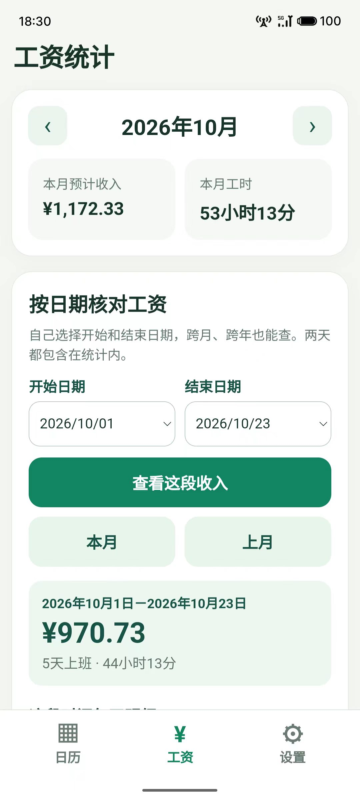
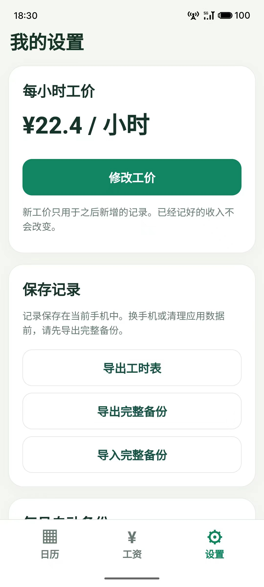

# 记工日历 · Jigong Calendar

一个简单、清楚、适合手机使用的记工日历，用于记录每天工时并估算工资。

**A privacy-first work-hours and wage tracker for web and Android.**

## 在线体验

👉 **[打开网页版 Demo](https://jigong-calendar.vividpika32.chatgpt.site)**

数据保存在当前设备中，不需要注册账号，也不会自动上传到服务器。

## 界面预览

### 日历与当月收入


### 工资统计



### 工价与备份设置



## 功能

- 按月查看日历和上班记录
- 支持一天记录多个工作时段
- 自动扣除时段之间的休息时间
- 支持跨夜班计算
- 按月、按周和自定义日期范围统计工时与预计收入
- 支持复制前一天或本周记录
- 支持导出 CSV 工时表和 JSON 完整备份
- 安卓版支持每月自动备份
- 数据保存在当前设备，不会自动上传服务器

## 使用方法

1. 在“设置”中填写每小时工价。
2. 点击日期，选择“上班”或“休息”。
3. 填写一个或多个工作时段并保存。
4. 在“工资”页面查看统计结果。
5. 更换设备前先导出完整备份。

预计收入仅供记录和核对，实际工资请以最终结算为准。

## 项目结构

- `dist/`：网页版
- `android-app/`：安卓项目
- `tests/`：测试文件
- `docs/screenshots/`：界面截图

## 安卓版

安卓项目位于 [android-app](./android-app)。

需要 Android Studio/SDK、JDK 17、Android Gradle Plugin 8.6.1 和 compileSdk 35。项目未提交本地 SDK、Gradle 缓存、签名密钥和本机路径配置。发布版本请自行配置签名。

## 测试

```bash
node --test tests/logic.test.cjs
```

## 隐私

记录保存在当前设备的浏览器本地存储中，请定期导出完整备份，并妥善保管备份文件。

## License

建议在使用前确认并补充适合你的开源许可证。
